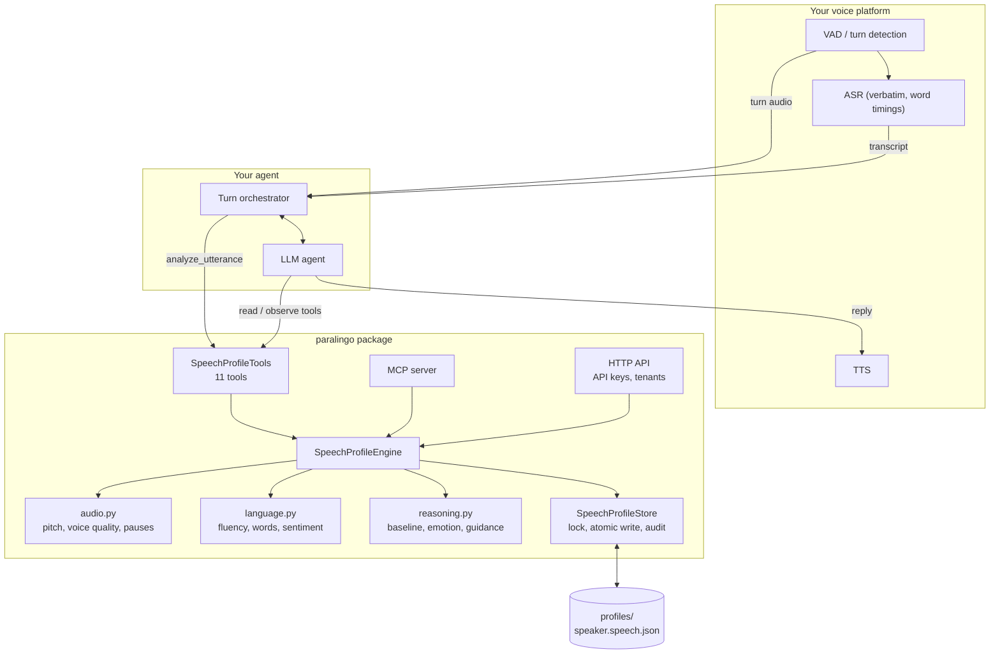
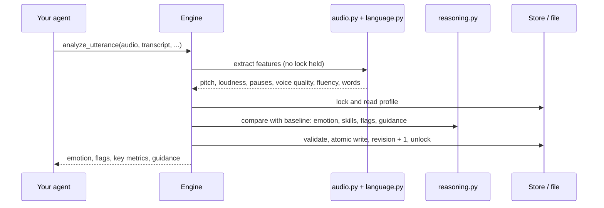

# Architecture

## Components

| Module | Responsibility |
|---|---|
| `audio.py` | Pitch (autocorrelation), HNR, jitter and shimmer (cycle-to-cycle cross-correlation), loudness, pauses, audio quality |
| `language.py` | Fillers, repetitions, stuttering-like disfluencies, vocabulary, hedging, sentiment |
| `reasoning.py` | Personal baseline (running mean and variance), emotion, skills, speaking style, indicators, guidance |
| `engine.py` | Sessions, utterances, observations, accent, consent, summaries, trends |
| `store.py` | One file per speaker; locking, atomic writes, revisions, schema validation, retention, audit log |
| `agent_tools.py` | Tool definitions (Anthropic, OpenAI, MCP) and a dispatcher that never raises |
| `http_api.py`, `api_keys.py` | HTTP API with hashed API keys, scopes, tenants and rate limits |
| `mcp_server.py`, `__main__.py` | MCP server and command line |

## What happens on each turn

Feature extraction runs before the lock is taken, so the lock is held only briefly: read, reason, write.
At `end_session`, the session is summarised, indicators are checked against the person's past baseline,
and then the session is folded into the baseline and trends.

## Design principles

* **Compare people with themselves.** Pitch and loudness vary hugely between people and microphones, so
  emotion and change detection use each person's own baseline.
* **Explain every inference.** Each estimate stores its cues, confidence and method.
* **Be humble about health.** Indicators are opt-in, non-diagnostic, list their confounders, and must
  recur across sessions before they're called persistent.
* **Never block the call.** Paralingo works on finished turns, outside the audio stream, and tools return
  errors instead of raising.

A longer design document with HLD and LLD diagrams is in [`architecture.html`](architecture.html); download
it and open it in a browser.
