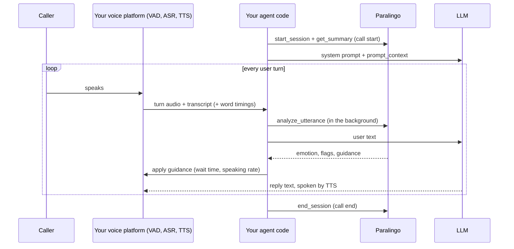

# Integration guide

How to add Paralingo to a voice agent. It works with any stack: any speech-to-text (ASR), any
text-to-speech, any LLM, and any voice platform. It only needs each finished user turn, as audio and/or
a transcript.

## How it fits



Your code makes **three calls**: `start_session` when the call starts, `analyze_utterance` after each user
turn, and `end_session` when the call ends. The LLM can also read and write the profile through tools.

## Step 1: Choose a stable speaker ID

Use the same ID every time the same person calls, but don't use raw personal data. A salted hash of the
phone number or your customer ID works well:

```python
import hashlib

def speaker_id_for(phone_number: str, salt: str = "change-me-and-keep-secret") -> str:
    return "caller-" + hashlib.sha256((salt + phone_number).encode()).hexdigest()[:16]

print(speaker_id_for("+15551234567"))
```

## Step 2: Record consent

Analysis is on by default; health indicators are off until the person opts in. Record what the person
agreed to, ideally right after your consent prompt:

```python
from paralingo import SpeechProfileEngine

eng = SpeechProfileEngine("profiles", agent_id="support-bot")
eng.set_consent(
    "caller-demo",
    recording=True,            # you may store audio references
    voice_analysis=True,       # prosody, emotion, skills (required for analysis)
    health_indicators=False,   # non-diagnostic speech-health signals: opt-in only
    store_transcripts=True,    # False keeps only derived numbers, never the words
    retention_days=180,        # older sessions are deleted automatically
    granted_via="verbal-consent-recorded",
)
```

See [Privacy, consent and deployment](privacy-and-deployment.md) for what each flag does.

## Step 3: At call start, load what is known

```python
sid = eng.start_session("caller-demo", channel="phone", context="order status")
summary = eng.get_summary("caller-demo")

system_prompt = "You are a helpful phone agent. Keep replies short.\n\n" + summary["prompt_context"]
guidance = summary["agent_guidance"]
print(system_prompt)
```

`prompt_context` is a ready-made text block describing the person's speaking style, recent emotion,
accent, any active indicators and how to adapt. Apply the numeric guidance to your voice stack:

| Guidance field | Apply it to |
|---|---|
| `end_of_turn_silence_ms` | Your VAD / endpointing silence timeout, so the agent doesn't interrupt this person |
| `recommended_speaking_rate_wpm` | Your TTS speaking rate |
| `adaptations` | Already in `prompt_context`; each has an `instruction`, `reason` and `priority` |

Fields are `None` until there is enough data; keep your defaults in that case.

## Step 4: After each user turn, analyse it

Pass whatever your platform gives you. More inputs give a richer analysis:

| Input | Gives you |
|---|---|
| `audio_path` (WAV file) or `samples` + `sample_rate` (NumPy array) | Pitch, loudness, voice quality, pauses, audio quality |
| `transcript` | Fillers, repetitions, vocabulary, hedging, sentiment, pace |
| `word_timestamps`: `[{"word", "start", "end"}]` in seconds | Pauses and pace when you have no audio |
| `response_latency_s` | How long the person took to start answering |
| `external` | Other models' outputs, e.g. `{"emotion": {...}, "asr_confidence": 0.93}` |

Analysis takes about 0.1–0.3 s per turn. Run it **in parallel** with your LLM call so it never delays
the reply; its guidance then applies from the next turn:

```python
from concurrent.futures import ThreadPoolExecutor
import numpy as np

executor = ThreadPoolExecutor(max_workers=2)

def on_user_turn(speaker: str, session_id: str, audio: np.ndarray, sample_rate: int, transcript: str,
                 latency_s: float):
    future = executor.submit(
        eng.analyze_utterance, speaker, session_id=session_id,
        samples=audio, sample_rate=sample_rate, transcript=transcript, response_latency_s=latency_s,
    )
    # ... send `transcript` to your LLM here, in parallel ...
    return future

# simulate one 1.5 s turn at 16 kHz
sr = 16000
t = np.arange(int(1.5 * sr)) / sr
audio = np.concatenate([np.zeros(4000), 0.3 * np.sin(2 * np.pi * 160 * t), np.zeros(4000)])
result = on_user_turn("caller-demo", sid, audio, sr, "Hi, where is my order?", 0.6).result()

g = result["guidance"]
print(result["emotion"]["label"], result["flags"], g["end_of_turn_silence_ms"])
```

**Get verbatim transcripts.** Many ASR services remove "um", "uh" and repetitions by default, which hides
fluency information. Turn on their verbatim or disfluency option if they have one.

## Phone audio (8 kHz µ-law)

Telephony streams (for example Twilio Media Streams) usually deliver 8 kHz G.711 µ-law bytes. Decode
them to floats and pass them as `samples`; Paralingo adjusts its pitch tracking for 8 kHz audio
automatically.

```python
import numpy as np

def mulaw_to_float(data: bytes) -> np.ndarray:
    """Decode G.711 µ-law bytes to float samples in [-1, 1]."""
    u = ~np.frombuffer(data, dtype=np.uint8)
    sign = (u & 0x80) != 0
    exponent = ((u >> 4) & 0x07).astype(np.int32)
    mantissa = (u & 0x0F).astype(np.int32)
    magnitude = ((mantissa << 3) + 0x84) << exponent
    sample = (magnitude - 0x84).astype(np.float64)
    return np.where(sign, -sample, sample) / 32768.0

# e.g. after collecting one turn's bytes from your telephony stream:
# eng.analyze_utterance(speaker, session_id=sid, samples=mulaw_to_float(turn_bytes), sample_rate=8000,
#                       transcript=text)
print(mulaw_to_float(bytes([0xFF, 0x7F, 0x00, 0x80])))
```

Phone codecs make voice-quality measures (jitter, shimmer, HNR) less reliable, which is why health
indicators compare a person only with their own baseline, and skip poor-quality audio.

## Step 5: Give your LLM the tools

The LLM can read the profile and record what it notices. Give it the **read and observe** tools only;
your code keeps the audio tools:

```python
from paralingo import SpeechProfileTools

llm_tools = SpeechProfileTools("profiles", agent_id="llm", include_pipeline_tools=False)

anthropic_tools = llm_tools.definitions("anthropic")   # [{"name", "description", "input_schema"}]
openai_tools = llm_tools.definitions("openai")         # [{"type": "function", "function": {...}}]
print([t["name"] for t in anthropic_tools])

# When the model calls a tool, run it and send the JSON string back as the tool result:
result_json = llm_tools.execute("paralingo_get_guidance", {"speaker_id": "caller-demo"})
print(result_json[:120])
```

`execute` never raises: errors come back as `{"ok": false, "error": "..."}`, so a failed tool call
can't crash your agent. See the [tool reference](tools-reference.md) for every tool.

With the Anthropic Python SDK, pass the definitions as `tools` and run each `tool_use` block through
`execute`:

```python
# sketch: requires the anthropic package and an API key
import json
import anthropic

client = anthropic.Anthropic()
messages = [{"role": "user", "content": "Hi, where is my order?"}]
while True:
    response = client.messages.create(model="claude-opus-5-5", max_tokens=16000,
                                      system=system_prompt, tools=anthropic_tools, messages=messages)
    messages.append({"role": "assistant", "content": response.content})
    if response.stop_reason != "tool_use":
        break
    messages.append({"role": "user", "content": [
        {"type": "tool_result", "tool_use_id": b.id, "content": llm_tools.execute(b.name, b.input)}
        for b in response.content if b.type == "tool_use"]})
```

A complete runnable version is in [`examples/claude_voice_agent.py`](../examples/claude_voice_agent.py).
For OpenAI-style APIs, pass `definitions("openai")` and call
`llm_tools.execute(call.function.name, call.function.arguments)`; `execute` accepts the JSON string
directly.

## Step 6: At call end, close the session

```python
summary = eng.end_session("caller-demo", sid)
print(summary["dominant_emotion"], summary["skills_mean"].get("overall"))
```

This updates the person's baseline, per-session trends, rolling skill scores, speaking style, speech
indicators (if consented) and guidance for the next call.

## Using it from voice frameworks

Paralingo doesn't hook into the live audio stream, so it fits any framework. Call it from the point
where your framework tells you a user turn has finished:

| Platform type | Where to call `analyze_utterance` | What you can pass |
|---|---|---|
| Self-hosted pipelines (Pipecat, LiveKit Agents, your own) | Your end-of-turn / user-transcript handler | Turn audio + transcript + word timings |
| Telephony streams (Twilio and similar) | When your VAD closes a turn | µ-law audio decoded as above + your ASR transcript |
| Hosted agents that only send webhooks (some Vapi or Retell setups) | Your transcript webhook | Transcript and word timings (no audio) |

```python
# sketch: the shape of an end-of-turn handler in any framework
def on_turn_finished(event):
    executor.submit(eng.analyze_utterance, event.speaker_id, session_id=event.call_id,
                    samples=event.audio, sample_rate=event.sample_rate,
                    transcript=event.text, word_timestamps=event.words)
```

## Other ways to connect

* **Any language:** run the [HTTP API](http-api.md) and call it with API keys.
* **MCP:** `paralingo-mcp --root ./profiles --audio-root ./recordings` exposes the tools to any MCP
  client. For Claude Desktop or Claude Code, add to your MCP config:

  ```json
  {"mcpServers": {"paralingo": {"command": "paralingo-mcp",
    "args": ["--root", "C:/data/profiles", "--no-pipeline-tools"]}}}
  ```

* **Command line:** `paralingo --root profiles summary caller-42 --text-only` and other commands; run
  `paralingo --help`.

## Several agents, one profile

Any number of agents and processes on the **same machine** can share a `profiles` folder safely: writes
are locked and atomic, and every change is logged in the file's `audit_log` with the writer's `agent_id`.
Don't put the folder on a synced (OneDrive, Dropbox) or network drive; for several machines, run the
[HTTP API](http-api.md) as a shared service.
